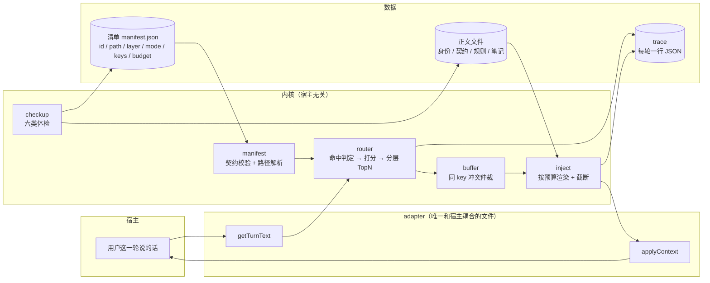

# ARCH · 一张图看懂

## 一条轮次的完整路径

1. **adapter.getTurnText()** 从宿主拿到这轮用户说了什么
2. **router** 读清单，用每条单元的 `keys` 做命中判定，打分，按层取 TopN
3. **buffer** 处理「同一个 key 挂了两个单元」的情况：按层优先级仲裁，败者进缓冲留痕
4. **inject** 按 `mode` 渲染（excerpt 正文 / pointer 一行 / lookup 摘要 + 路径），
   再按 `budget` 截断，超预算的部分记进 `clipped`
5. **trace** 把这一轮的一切写成一行 JSON：命中、理由、字符、裁剪、悬空
6. **adapter.applyContext(text)** 把结果交回宿主

## 三个设计上的「断点」

这三处是**故意的边界**，改动时要想清楚：

| 断点 | 含义 | 为什么要有 |
|---|---|---|
| `adapter` 四个方法 | 宿主差异只在这一个文件里 | 换宿主 = 另写一个 adapter，内核一行不改 |
| `manifest` 是数据不是代码 | 加一条记忆＝改 JSON，不写 if-else | 可 diff、可评审、可回滚 |
| `keys` 是唯一触发源 | 触发词只在一个地方 | 否则「为什么命中」永远说不清 |

## 数据流里的两个约束

- **预算优先于完整**：一条单元超过 budget 就截断，不因为是「重要内容」就突破。
  破了例，预算就不再是判据，只是建议。
- **悬空必须留痕**：路径找不到不算致命（不能因为一个文件丢了就整体不注入），
  但必须写进 trace 与体检 —— 静默失效是这套系统最怕的失败模式。
